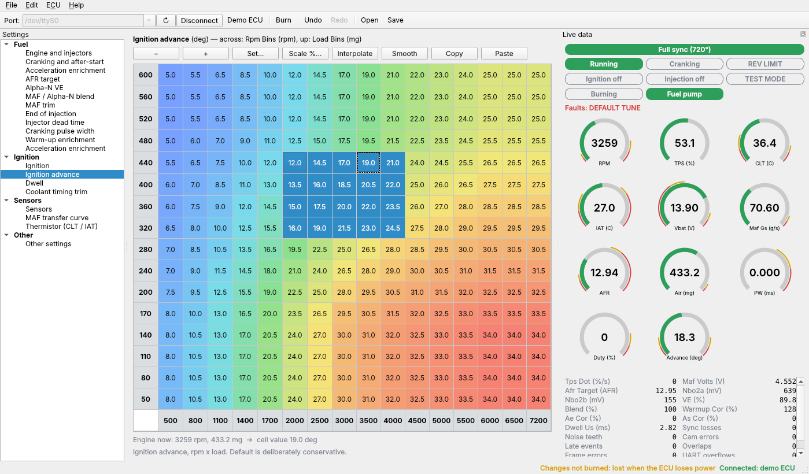

# Tuning

Three ways to tune the ECU: **our own tuner** (below), TunerStudio, and the command-line tool.

The files `e36ecu.ini` and `ecu_def.json` in this folder are **generated** from
`definitions/ecu.toml` by `tools/codegen/gen.py`. Don't edit them by hand.

| File | Used by |
|------|---------|
| `e36ecu.ini` | TunerStudio |
| `ecu_def.json` | our tuner (`e36tuner/`) and `tools/ecu_cli.py` |

## Our tuner (`e36tuner/`)



```sh
pip install -r tuner/requirements.txt        # PySide6, pyqtgraph, pyserial (developed on Python 3.13)
python3 tuner/run_tuner.py                   # start; choose the port and press Connect
python3 tuner/run_tuner.py --demo            # no hardware: a pretend ECU and engine inside the program
python3 tuner/run_tuner.py --port /dev/ttyACM0 my.tune
```

What it does (plan milestones T1–T3):

- **Connect and view.** Serial connect with a firmware check (a firmware from another version is
  refused with a clear message), gauges with warning zones, status lights (sync, running, rev
  limit, outputs on, burning), sensor faults, error counters and a numeric list of the live data.
- **Edit.** Every setting, grouped as in TunerStudio (Fuel / Ignition / Sensors). Tables are
  heat-map coloured with the highest load at the top; the outlined cell is where the engine is
  running now. Select a block and: type a number, `+` / `-` (one step; Ctrl = ten), `*` scale by
  %, `I` interpolate (follows the axis spacing), `S` smooth, Ctrl+C / Ctrl+V to and from a
  spreadsheet. Axis bins are edited in the same grid. Curves have a plot beside the numbers.
  Unlimited undo / redo.
- **Live write and burn.** Every edit (and every undo) goes to the ECU's working memory straight
  away. **Burn** stores it in the EEPROM; until then the status bar says the changes are not
  burned. Before burning, the tuner checks that the ECU really holds the tune shown.
- **Tune files.** Save / open (the same JSON format as `tools/ecu_cli.py`), edit offline with no
  ECU, compare with another tune file (list of differences, cell-by-cell grid, copy settings
  across). A file saved by a different firmware layout is imported by setting name, with a
  report of anything that could not be carried over.

Things worth knowing:

- Opening the port restarts an Arduino Mega; connecting takes about 2 seconds.
- If the tune in the ECU differs from the one open in the tuner, you are asked which one to keep.
- Switching `ignEnable` / `injEnable` on while connected, or loading a file that has them on, asks
  first: with real coils or injectors wired up they are driven as soon as the engine turns.
- If the link drops, the tuner goes offline and keeps your tune; reconnect to carry on.
- The demo ECU is a toy model for trying the program. Its numbers follow the tune but are **not**
  the firmware's maths.

Not in this version: a 3D surface view of tables, datalogging and the log viewer (T4), tooth /
knock views and the output test panel (T5; use `tools/ecu_cli.py` for those today), auto-tune
(T6), firmware flashing (T7).

**Tested** with the built-in demo ECU and against the real firmware running in the simavr
simulator (`make test` and `make tuner-test` in `firmware/`), without a display. **Not yet tested**
on a real board, or by hand on Windows / macOS.

## TunerStudio

1. Install TunerStudio MS (the free "Lite" version is enough).
2. **File → New Project**, name it, and when asked for the firmware choose **Other / Browse** and
   select `tuner/e36ecu.ini` from this repository.
3. Connection: the ECU's serial port at **115200** baud.
4. The ECU's signature must match the ini (`E36ECU-dev-p4` for this version). If the firmware and
   the ini come from different versions, TunerStudio will refuse to connect, which is intended.

Menus: **Fuel** (engine and injectors, cranking, acceleration, AFR / VE / blend / MAF-trim /
end-of-injection tables, dead-time / cranking / warm-up curves), **Ignition** (enable, TDC offset,
cam mode, advance table, dwell and coolant-trim curves), **Sensors** (TPS calibration, battery,
wideband, MAF and thermistor curves). Changes are live in the ECU's RAM; **Burn** stores them.

**Not yet tested with TunerStudio itself** (it can't run where this was built). The ini follows
the TunerStudio format and is checked for internal consistency (every offset, size and name
matches the firmware), but if TunerStudio reports an error, note the message and the line and
the generator can be fixed.

## Command line (`tools/ecu_cli.py`)

Works today and was tested against the simulated ECU:

```sh
pip install pyserial
python3 tools/ecu_cli.py PORT watch                 # live data
python3 tools/ecu_cli.py PORT tune list             # every setting
python3 tools/ecu_cli.py PORT tune get ignTable     # a table, printed as a grid (top row = highest load)
python3 tools/ecu_cli.py PORT tune set injFlow 240
python3 tools/ecu_cli.py PORT tune set loadSource alpha-n
python3 tools/ecu_cli.py PORT tune burn             # store in EEPROM
python3 tools/ecu_cli.py PORT tune save base.tune   # back up to a file
python3 tools/ecu_cli.py PORT tune load base.tune   # restore (then `tune burn`)
```

Values are in real units (rpm, ms, degrees, %); out-of-range values are refused before they are
sent. A tune file records the firmware layout, so a file from a different layout is refused.

## Before anything runs an engine

The default tune is a **safe starting point, not a tune**: ignition and injection outputs are
**off** (`ignEnable`, `injEnable`), timing is conservative, mixtures are rich, and several values are
placeholders that must be set from the real parts first:

- `injFlow` and `injDead`: from the motorcycle injectors' data (or a flow test).
- `mafV` / `mafFlow`: the transfer curve of the actual HFM part number.
- `thermAdc` / `thermC`: check against the real coolant and air-temperature sensors.
- `tdcOffset`: measured with a timing light (Phase 8).
- `crankPw`, `warmup`: starting points only.

The live data shows **DEFAULT TUNE** (fault bit 7) until a tune has been burned.
